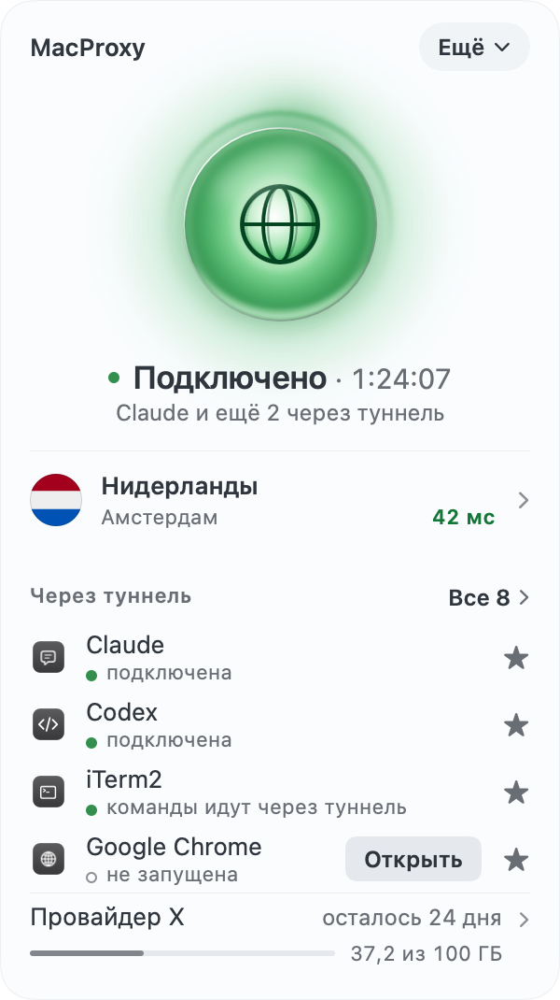
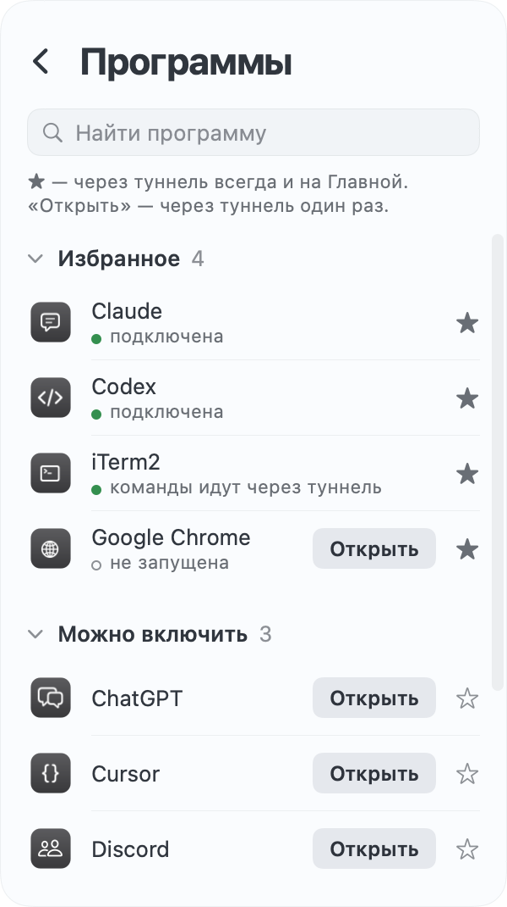
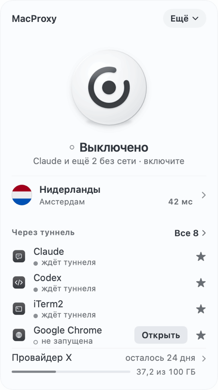
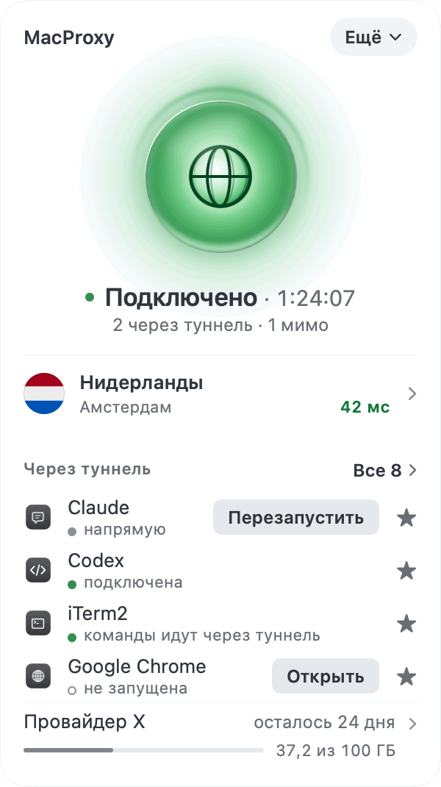
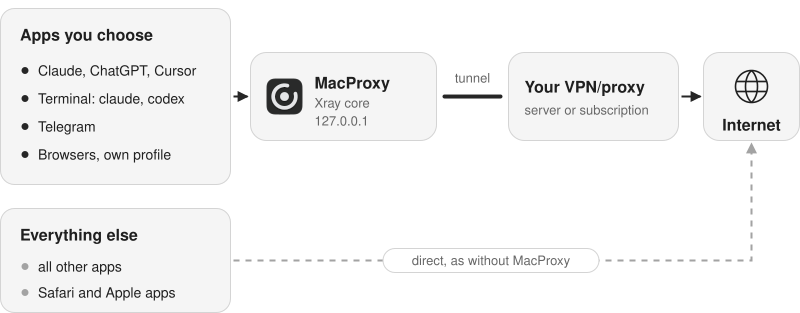
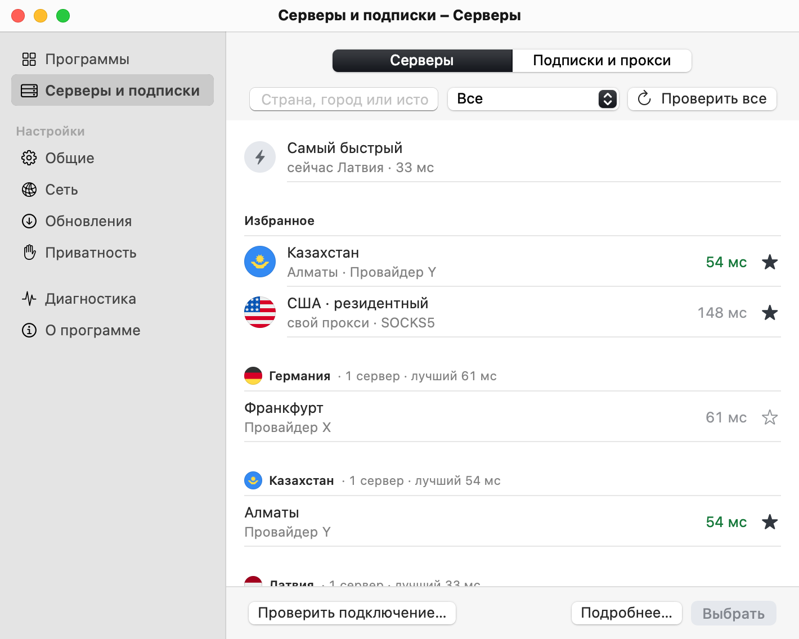
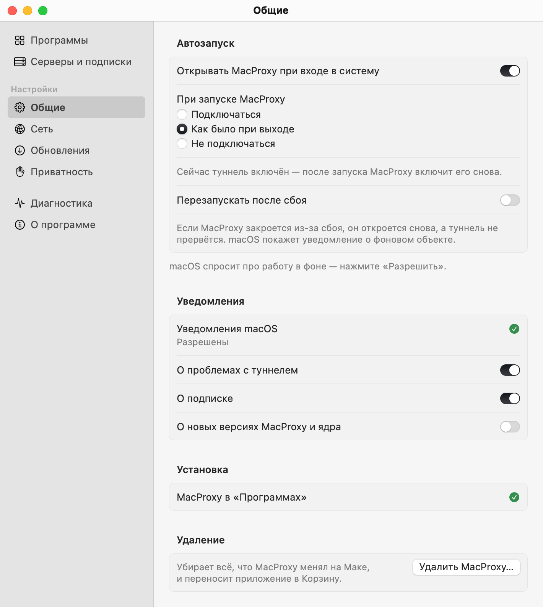
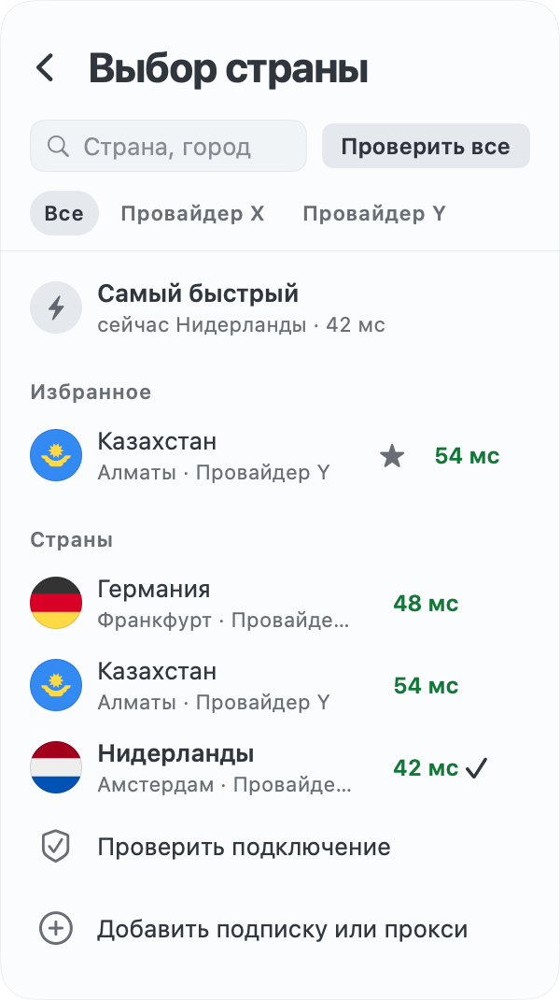
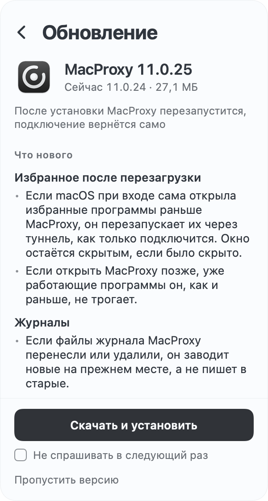

<p align="right"><b>English</b> | <a href="README.ru.md">Русский</a></p>

<p align="center">
  
</p>

<h1 align="center">MacProxy</h1>

<p align="center"><b>Claude Code, Codex, Telegram and the apps you choose — through your own VPN/proxy.</b><br>
A macOS menu bar app: only the apps you pick go through the tunnel, the rest of your Mac stays direct.</p>

<p align="center">
  <a href="https://github.com/agwor/macproxy/releases/download/v11.0.27-757/MacProxy-11.0.27-757-macos-arm64.dmg"><b>Download MacProxy 11.0.27</b></a> (DMG, 27.5 MB) ·
  <a href="https://github.com/agwor/macproxy/releases">All releases</a> ·
  <a href="https://agwor.github.io/macproxy/">Website</a>
  <br>
  <sub>Apple Silicon only · macOS 14 or later · build 757, November 25, 2026 · the app's interface is in Russian for now</sub>
</p>

<p align="center">
  <picture>
    <source media="(prefers-color-scheme: dark)" srcset="img/home-dark.png">
    
  </picture>
  &nbsp;&nbsp;
  <picture>
    <source media="(prefers-color-scheme: dark)" srcset="img/apps-dark.png">
    
  </picture>
</p>

> [!NOTE]
> MacProxy is a VPN client for individual apps, not a VPN service: it does not sell servers. You need your own subscription or
> proxy from a VPN provider — a link like `https://…`, `vless://…` or `socks5://…`.

## Why MacProxy

- **Only the apps you choose.** Claude, ChatGPT, Codex, Cursor and other Electron and Chromium apps are started with a proxy setting for
  that app only. Starred (★) apps always go through the tunnel: open one from the Dock or Spotlight and MacProxy restarts it through the
  tunnel.
- **Terminal and Claude Code.** The `claude` and `codex` commands go through the tunnel on their own, `proxy_env` turns it on for the current
  tab. Claude Code also gets the proxy in `~/.claude/settings.json`. Shell files change only if you tick Claude Code, Codex CLI or Terminal.
- **Browsers in a separate profile.** Chrome, Arc, Brave, Edge, Firefox and other browsers open in a MacProxy profile: the whole browser or
  only the sites on your list.
- **Telegram:** MacProxy can fill in the proxy for you (the button opens the proxy settings in Telegram; you confirm there). For other apps with their own proxy settings it shows the address.
- **Your Mac's network settings stay as they are.** No system proxy, no changes to routes or DNS, no admin password. Safari and Apple apps
  go direct.
- **Subscriptions and servers.** Subscription links, `vless://`, `vmess://`, `trojan://`, `ss://`, your own SOCKS5 and HTTP(S) proxies,
  QR codes. “Fastest” picks a server for you; latency is shown for each.
- **Checks.** A step-by-step connection check, the exit country and a services check (Claude, the Anthropic API, ChatGPT, GitHub).
- **Nothing leaks when the tunnel is off.** By default apps started through MacProxy stay offline instead of going direct.

<p align="center">
  <picture>
    <source media="(prefers-color-scheme: dark)" srcset="img/connect-dark.gif">
    
  </picture>
  &nbsp;&nbsp;
  <picture>
    <source media="(prefers-color-scheme: dark)" srcset="img/restart-dark.gif">
    
  </picture>
  <br>
  <sub>One button connects the tunnel · an app opened directly comes back through the tunnel with “Restart”</sub>
</p>

## How it works

<picture>
  <source media="(prefers-color-scheme: dark)" srcset="img/how-en-dark.svg">
  
</picture>

MacProxy runs the Xray core and a local proxy that listens only on `127.0.0.1`. The apps you pick reach it in the way that suits each of
them — launch flags, environment variables in Terminal, a separate browser profile or the app's own proxy setting — and their traffic goes
through the tunnel to your server. Other apps don't know about the tunnel.

## More screens

<p align="center">
  <picture>
    <source media="(prefers-color-scheme: dark)" srcset="img/servers-dark.png">
    
  </picture>
</p>
<p align="center">
  <picture>
    <source media="(prefers-color-scheme: dark)" srcset="img/settings-dark.png">
    
  </picture>
</p>
<p align="center">
  <picture>
    <source media="(prefers-color-scheme: dark)" srcset="img/place-dark.png">
    
  </picture>
  &nbsp;&nbsp;
  <picture>
    <source media="(prefers-color-scheme: dark)" srcset="img/update-dark.png">
    
  </picture>
</p>

<sub>Screenshots use demo data. The interface is in Russian; an English version is not available yet.</sub>

## Install

**Requirements:** a Mac with Apple Silicon (M1 or later), macOS 14 or later. There is no build for Intel Macs.

1. Open the downloaded image and drag **MacProxy** into **Applications**, then eject the image.
2. Open MacProxy from Applications. The build is not notarized by Apple yet, so macOS will say it cannot verify the app — click
   **Done**.
3. Open **System Settings → Privacy & Security** and, at the bottom, click **Open Anyway** next to MacProxy; confirm with your password or
   Touch ID.

A fallback instead of steps 2–3 — one command in Terminal once MacProxy is in Applications:

```sh
xattr -dr com.apple.quarantine /Applications/MacProxy.app
```

There is no Dock icon: MacProxy lives in the menu bar.

### Verify the download

Compare the checksum of the downloaded image with this one (it is also in the `SHA256SUMS` file of every release):

```sh
shasum -a 256 ~/Downloads/MacProxy-11.0.27-757-macos-arm64.dmg
```

```
06f7597640072b195f98e467eec7e4c9aac51f2cb79a21c703a7db04a2584556  MacProxy-11.0.27-757-macos-arm64.dmg
```

## Updates

MacProxy checks for updates itself and shows a new version on its main screen; the update sheet shows the release notes and installs it
with one button. Updates come through [Sparkle](https://sparkle-project.org): the update feed and every archive are signed (EdDSA), and
MacProxy installs only what is signed with the project's key. The Xray core can be updated separately in Settings → Updates.

## Uninstall

1. In MacProxy: **Settings → General → “Удалить MacProxy…”** (Uninstall). It turns off the tunnel, removes the MacProxy block from
   `~/.zshrc` (for bash — from `~/.bash_profile`, `~/.bash_login` or `~/.profile`) and its proxy keys from `~/.claude/settings.json`
   (nothing else in these files changes), the “… (proxy)” launchers in `~/Applications`, autostart and relaunch after a crash, and then
   moves the app to the Trash. Subscriptions and settings are erased only if you tick the checkbox.
2. If the app is already in the Trash:
   - in `~/.zshrc`, `~/.bash_profile`, `~/.bash_login`, `~/.profile` and `~/.bashrc` (whichever exist) delete the lines from
     `# >>> macproxy >>>` to `# <<< macproxy <<<`;
   - in `~/.claude/settings.json` — `HTTPS_PROXY`, `HTTP_PROXY` and `NO_PROXY` under `env` (the proxy ones point to `127.0.0.1`); delete the copy
     `~/.claude/settings.json.bak-macproxy` (your file before MacProxy) if you don't need it;
   - delete the `~/.config/macproxy` folder and the “… (proxy).app” launchers in `~/Applications` (and from the Dock, if you put them there);
   - remove MacProxy in **System Settings → General → Login Items & Extensions**.
3. Data lives in `~/Library/Application Support/MacProxy`, `~/Library/Logs/MacProxy` and `~/Library/Caches/MacProxy` — you can delete them.
   App preferences: `defaults delete io.github.agwor.macproxy`.

## Privacy

**On your Mac.** Subscriptions, servers and settings are kept in `~/Library/Application Support/MacProxy` in files readable only by your
user account; logs are in `~/Library/Logs/MacProxy` (kept 14 days, at most 20 MiB, without server addresses, subscription links or
passwords).

**Where MacProxy connects on its own** — nowhere else; no analytics, no telemetry:

| What | Where |
| --- | --- |
| MacProxy updates | the update feed on GitHub Pages |
| Xray core versions | GitHub; a new core comes from there too |
| Subscriptions | your provider: the subscription address, the app name and a Mac fingerprint (a one-way hash) when the server list is refreshed |
| Connection check | an empty Google response (`generate_204`), through the tunnel |
| Exit country | ipinfo.io through the tunnel, Cloudflare as a fallback; can be turned off |
| Services check | Claude, the Anthropic API, ChatGPT and GitHub through the tunnel — only when you press the button |

Error reports are never sent automatically: a report is built when you press the button, shown in full, and goes wherever you send it.

## FAQ

<details>
<summary><b>Is MacProxy a VPN?</b></summary>

It is a VPN client for individual apps. MacProxy has no servers of its own: it connects to your VPN provider's server or to your proxy and
sends only the apps you chose through it.
</details>

<details>
<summary><b>Which servers does it support?</b></summary>

Subscriptions (`https://…`, a list of links as text or base64), `vless://`, `vmess://`, `trojan://` and `ss://` links, and your own SOCKS5,
HTTP and HTTPS proxies. Hysteria, TUIC, WireGuard and Clash or sing-box subscriptions are not supported.
</details>

<details>
<summary><b>Does it change my Mac's network settings?</b></summary>

No. MacProxy does not turn on a system proxy and does not change routes or DNS. Shell files and `~/.claude/settings.json` change only if
you tick Claude Code, Codex CLI or Terminal, and the uninstaller removes those changes.
</details>

<details>
<summary><b>Why can't Safari go through MacProxy?</b></summary>

Safari and other Apple apps go direct: MacProxy cannot tell which Apple app a connection belongs to. Use a browser in a MacProxy profile
instead.
</details>

<details>
<summary><b>Why does macOS warn me on first launch?</b></summary>

The build is signed ad hoc, without an Apple Developer ID, and is not notarized yet. Allow it once in Privacy & Security (see Install);
updates after that are checked by MacProxy's own signature.
</details>

<details>
<summary><b>Is there an English interface or an Intel build?</b></summary>

Not yet: the interface is in Russian, and builds are for Apple Silicon only.
</details>

<details>
<summary><b>Is the source code available?</b></summary>

No. This repository holds the ready builds, the update feed and this page.
</details>

## Components and licenses

MacProxy itself is closed-source; it bundles:

- [Xray-core](https://github.com/XTLS/Xray-core) — MPL 2.0, a separate `xray` binary inside the app;
- [Sparkle](https://sparkle-project.org) — MIT, updates;
- [Rive runtime](https://github.com/rive-app/rive-ios) — MIT, the main button animation;
- [circle-flags](https://github.com/HatScripts/circle-flags) — MIT, country flags.

The globe on the button, visible in the screenshots, is derived from “The Golden Glow Button” (Rive Community, #18655) by AmritAaryan, licensed under [CC BY 4.0](https://creativecommons.org/licenses/by/4.0/).

Full license texts are in `MacProxy.app/Contents/Resources/THIRD-PARTY-NOTICES.txt`.
