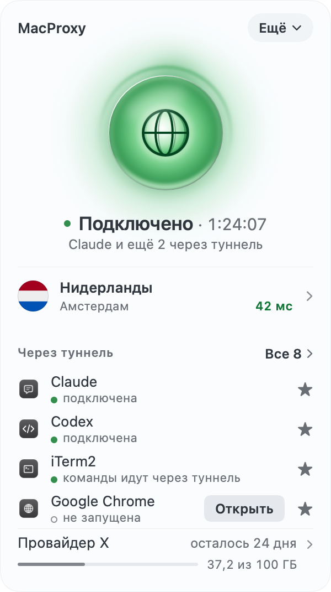
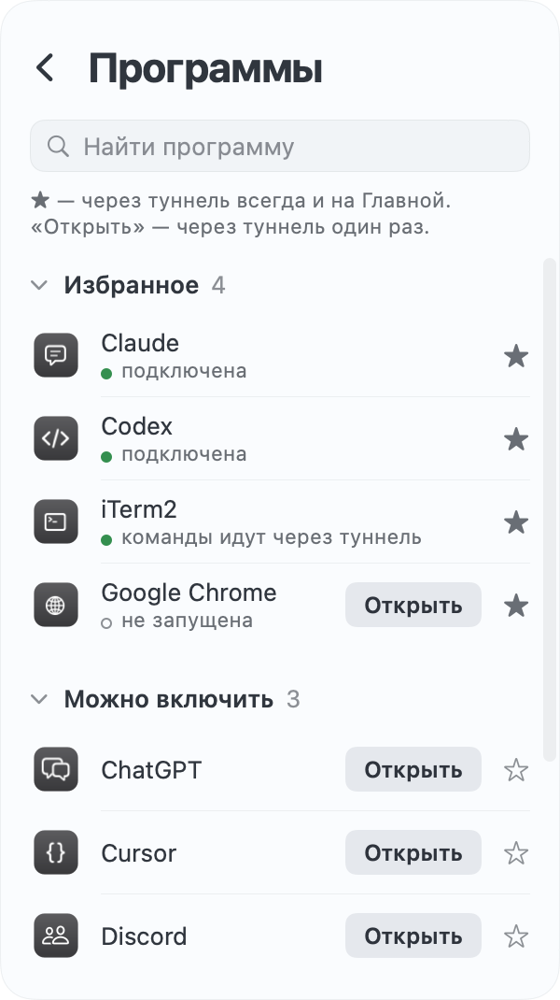
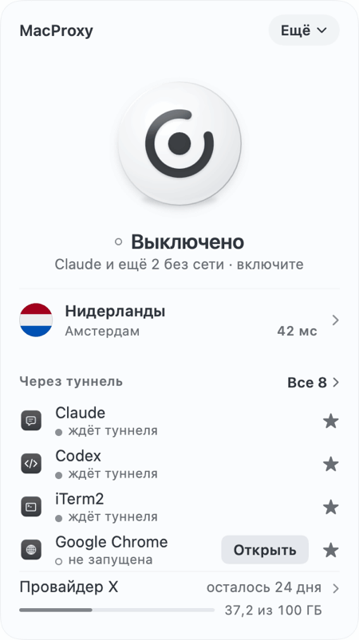
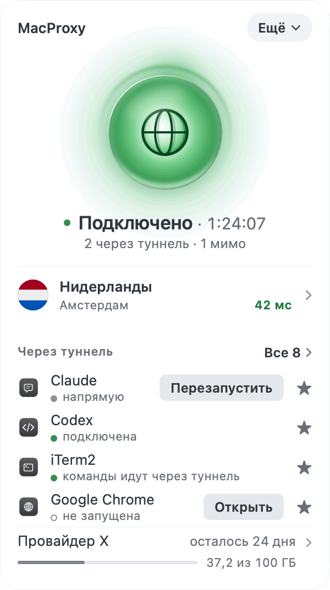
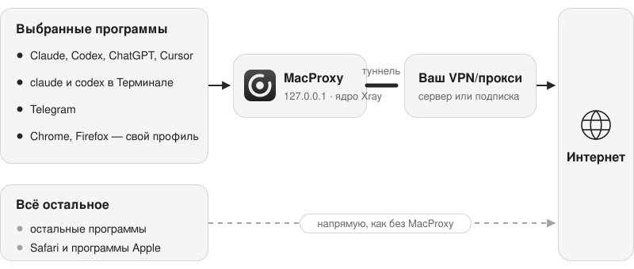
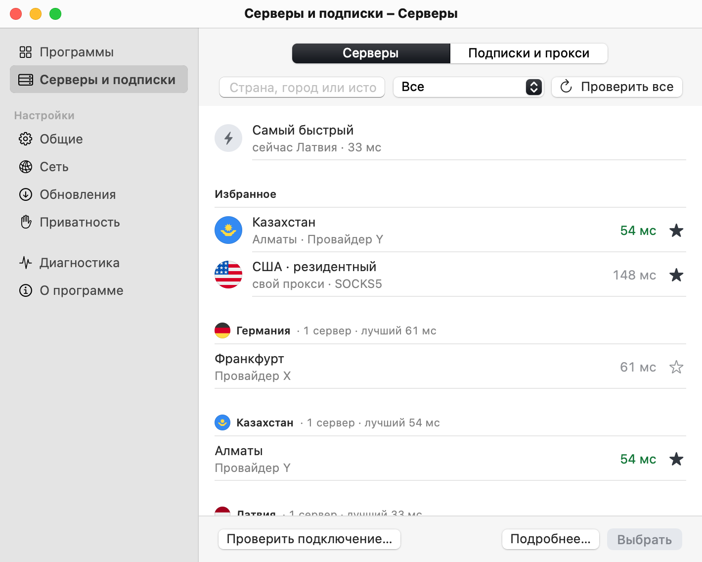
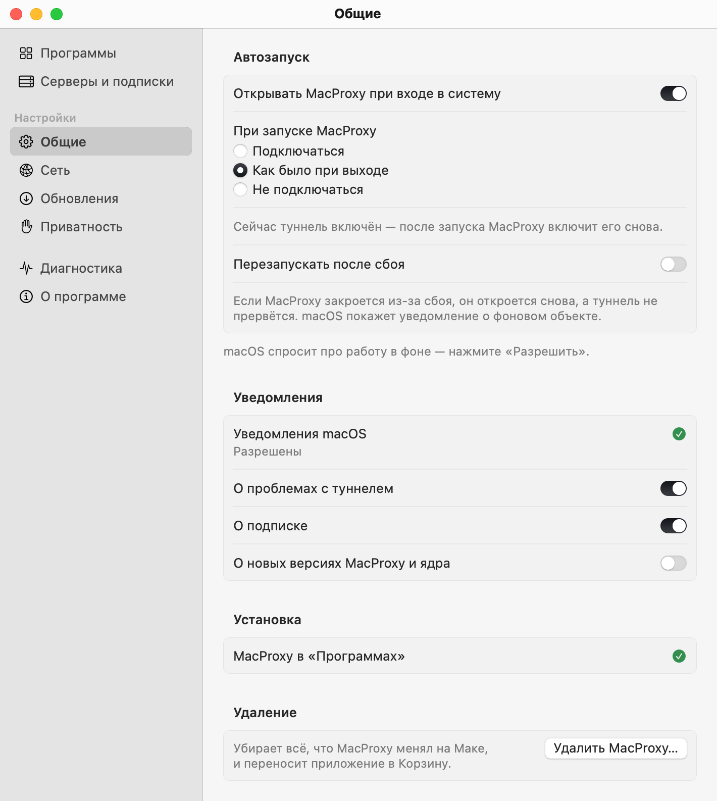
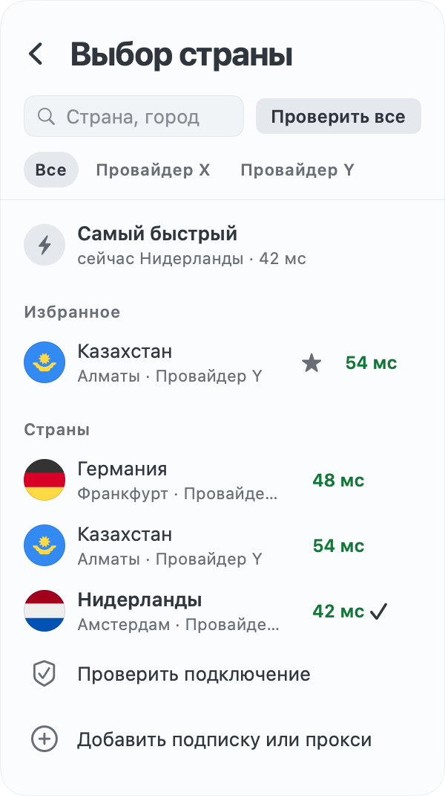
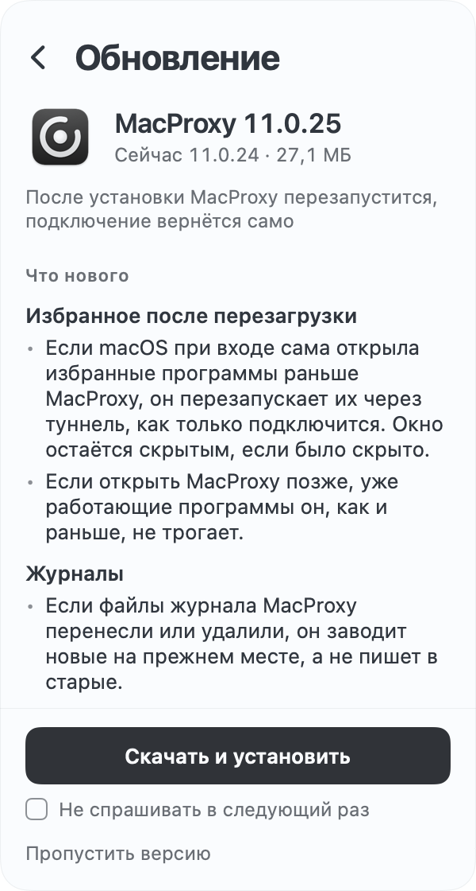

<p align="right"><a href="README.md">English</a> | <b>Русский</b></p>

<p align="center">
  
</p>

<h1 align="center">MacProxy</h1>

<p align="center"><b>Claude Code, Codex, Telegram и нужные вам программы — через ваш VPN/прокси.</b><br>
Приложение в строке меню macOS: через туннель идут только выбранные программы, остальной Мак — напрямую.</p>

<p align="center">
  <a href="https://github.com/agwor/macproxy/releases/download/v11.0.27-757/MacProxy-11.0.27-757-macos-arm64.dmg"><b>Скачать MacProxy 11.0.27</b></a> (DMG, 27,5 МБ) ·
  <a href="https://github.com/agwor/macproxy/releases">Все выпуски</a> ·
  <a href="https://agwor.github.io/macproxy/">Сайт</a>
  <br>
  <sub>Только Apple Silicon · macOS 14 или новее · сборка 757, 25 ноября 2026</sub>
</p>

<p align="center">
  <picture>
    <source media="(prefers-color-scheme: dark)" srcset="img/home-dark.png">
    
  </picture>
  &nbsp;&nbsp;
  <picture>
    <source media="(prefers-color-scheme: dark)" srcset="img/apps-dark.png">
    
  </picture>
</p>

> [!NOTE]
> MacProxy — VPN-клиент для отдельных программ, а не VPN-сервис: серверов он не продаёт. Нужна своя подписка или прокси от провайдера
> VPN — ссылка вида `https://…`, `vless://…` или `socks5://…`.

## Возможности

- **Только выбранные программы.** Claude, ChatGPT, Codex, Cursor и другие программы на Electron и Chromium MacProxy открывает с настройкой
  прокси только для этой программы. Отмеченные ★ идут через туннель всегда: открыли из Dock или Spotlight — MacProxy перезапустит через
  туннель.
- **Терминал и Claude Code.** Команды `claude` и `codex` идут через туннель сами, `proxy_env` включает его для текущей вкладки. Claude Code
  получает прокси и в `~/.claude/settings.json`. Файлы оболочки меняются, только если вы отметите Claude Code, Codex CLI или Терминал.
- **Браузеры в отдельном профиле.** Chrome, Arc, Brave, Edge, Firefox и другие браузеры открываются в профиле MacProxy: весь браузер или
  только сайты из списка.
- **Telegram:** MacProxy умеет подставить прокси сам (кнопка открывает настройку прокси в Telegram, подтверждаете там же). Остальным программам со своими настройками прокси подсказывает адрес.
- **Сетевые настройки Мака не меняются.** Системный прокси, маршруты и DNS MacProxy не трогает, пароль администратора не просит. Safari
  и программы Apple идут напрямую.
- **Подписки и серверы.** Ссылки подписок, `vless://`, `vmess://`, `trojan://`, `ss://`, свои прокси SOCKS5 и HTTP(S), QR-коды.
  «Самый быстрый» выберет сервер сам; у каждого видна задержка.
- **Проверки.** Пошаговая проверка подключения, страна выхода и проверка сервисов (Claude, API Anthropic, ChatGPT, GitHub).
- **Туннель выключен — ничего не утекает.** По умолчанию программы, запущенные через MacProxy, остаются без сети, а не идут напрямую.

<p align="center">
  <picture>
    <source media="(prefers-color-scheme: dark)" srcset="img/connect-dark.gif">
    
  </picture>
  &nbsp;&nbsp;
  <picture>
    <source media="(prefers-color-scheme: dark)" srcset="img/restart-dark.gif">
    
  </picture>
  <br>
  <sub>Туннель включается одной кнопкой · программа, открытая напрямую, возвращается в туннель кнопкой «Перезапустить»</sub>
</p>

## Как это работает

<picture>
  <source media="(prefers-color-scheme: dark)" srcset="img/how-ru-dark.svg">
  
</picture>

MacProxy запускает ядро Xray и локальный прокси, который слушает только `127.0.0.1`. Выбранные программы попадают в него так, как удобно
каждой: флагами запуска, переменными окружения в Терминале, отдельным профилем браузера или собственной настройкой прокси, — и идут через
туннель на ваш сервер. Остальные программы о туннеле не знают.

## Ещё экраны

<p align="center">
  <picture>
    <source media="(prefers-color-scheme: dark)" srcset="img/servers-dark.png">
    
  </picture>
</p>
<p align="center">
  <picture>
    <source media="(prefers-color-scheme: dark)" srcset="img/settings-dark.png">
    
  </picture>
</p>
<p align="center">
  <picture>
    <source media="(prefers-color-scheme: dark)" srcset="img/place-dark.png">
    
  </picture>
  &nbsp;&nbsp;
  <picture>
    <source media="(prefers-color-scheme: dark)" srcset="img/update-dark.png">
    
  </picture>
</p>

<sub>На снимках — демо-данные.</sub>

## Установка

**Требования:** Mac на Apple Silicon (M1 и новее), macOS 14 или новее. Для Mac с процессором Intel сборки нет.

1. Откройте скачанный образ и перетащите **MacProxy** в папку **«Программы»**. Затем извлеките образ.
2. Откройте MacProxy из «Программ». Сборка пока не нотаризована Apple, поэтому macOS скажет, что не может проверить приложение, —
   нажмите **«Готово»**.
3. Откройте **Системные настройки → Конфиденциальность и безопасность** и внизу нажмите **«Все равно открыть»** рядом с MacProxy,
   подтвердите паролем или Touch ID.

Запасной путь вместо шагов 2–3 — одна команда в Терминале, когда MacProxy уже лежит в «Программах»:

```sh
xattr -dr com.apple.quarantine /Applications/MacProxy.app
```

Значка в Dock нет: MacProxy живёт в строке меню.

### Проверка файла

Сравните контрольную сумму скачанного образа с этой (она же — в файле `SHA256SUMS` каждого выпуска):

```sh
shasum -a 256 ~/Downloads/MacProxy-11.0.27-757-macos-arm64.dmg
```

```
06f7597640072b195f98e467eec7e4c9aac51f2cb79a21c703a7db04a2584556  MacProxy-11.0.27-757-macos-arm64.dmg
```

## Обновления

MacProxy сам проверяет обновления и показывает новую версию на Главной; лист обновления показывает заметки к выпуску и ставит её одной
кнопкой. Обновления идут через [Sparkle](https://sparkle-project.org): лента обновлений и каждый архив подписаны (EdDSA), и MacProxy ставит
только то, что подписано ключом проекта. Ядро Xray обновляется отдельно: Настройки → Обновления.

## Как удалить

1. В MacProxy: **Настройки → Общие → «Удалить MacProxy…»**. Кнопка выключит туннель, уберёт строку MacProxy из `~/.zshrc` (у bash — из
   `~/.bash_profile`, `~/.bash_login` или `~/.profile`) и свои ключи прокси из `~/.claude/settings.json` (остальное в этих файлах не
   меняется), значки «… (proxy)» из `~/Applications`, автозапуск и перезапуск после сбоя, а затем перенесёт приложение в Корзину.
   Подписки и настройки стираются, только если отметить флажок.
2. Если приложение уже в Корзине:
   - в `~/.zshrc`, `~/.bash_profile`, `~/.bash_login`, `~/.profile` и `~/.bashrc` (какие есть) удалите строки от `# >>> macproxy >>>`
     до `# <<< macproxy <<<`;
   - в `~/.claude/settings.json` — `HTTPS_PROXY`, `HTTP_PROXY` и `NO_PROXY` в разделе `env` (прокси — с адресом `127.0.0.1`); копию
     `~/.claude/settings.json.bak-macproxy` (ваш файл до MacProxy) удалите, если она не нужна;
   - удалите папку `~/.config/macproxy` и значки «… (proxy).app» в `~/Applications`; если вы перетаскивали их в Dock — уберите и оттуда;
   - уберите MacProxy в **Системные настройки → Основные → Объекты входа и расширения**.
3. Данные лежат в `~/Library/Application Support/MacProxy`, `~/Library/Logs/MacProxy` и `~/Library/Caches/MacProxy` — их можно удалить.
   Настройки приложения — командой `defaults delete io.github.agwor.macproxy`.

## Приватность

**На Маке.** Подписки, серверы и настройки лежат в `~/Library/Application Support/MacProxy` в файлах, доступных только вашей учётной
записи; журналы — в `~/Library/Logs/MacProxy` (хранятся 14 дней, всего не больше 20 МиБ, без адресов серверов, ссылок подписок и
паролей).

**Куда MacProxy обращается сам** — больше никуда, ни аналитики, ни телеметрии:

| Что | Куда |
| --- | --- |
| Обновления MacProxy | лента обновлений на GitHub Pages |
| Список версий ядра Xray | GitHub; файл нового ядра — оттуда же |
| Подписки | провайдеру: адрес подписки, название программы и отпечаток Мака (необратимый хэш) при обновлении списка серверов |
| Проверка связи | пустой ответ Google (`generate_204`) через туннель |
| Страна выхода | ipinfo.io через туннель, запасной — Cloudflare; можно выключить |
| Проверка сервисов | Claude, API Anthropic, ChatGPT и GitHub через туннель — только по кнопке |

Отчёты об ошибках сами не уходят: отчёт собирается по вашей кнопке, показывается целиком и уходит туда, куда вы его отправите.

## Вопросы

<details>
<summary><b>MacProxy — это VPN?</b></summary>

Это VPN-клиент для отдельных программ. Своих серверов у MacProxy нет: он подключается к серверу вашего провайдера VPN или к вашему прокси
и пускает через него только выбранные программы.
</details>

<details>
<summary><b>Какие серверы подходят?</b></summary>

Подписки (`https://…`, список ссылок текстом или base64), ссылки `vless://`, `vmess://`, `trojan://` и `ss://`, свои прокси SOCKS5, HTTP
и HTTPS. Hysteria, TUIC, WireGuard и подписки Clash или sing-box не поддерживаются.
</details>

<details>
<summary><b>Меняет ли MacProxy настройки сети Мака?</b></summary>

Нет. Системный прокси MacProxy не включает, маршруты и DNS не меняет. Файлы оболочки и `~/.claude/settings.json` меняются, только если вы
отметите Claude Code, Codex CLI или Терминал, а удаление убирает эти правки.
</details>

<details>
<summary><b>Почему Safari не идёт через MacProxy?</b></summary>

Safari и другие программы Apple идут напрямую: MacProxy не может узнать, какой программе Apple принадлежит соединение. Для сайтов через
туннель откройте браузер в профиле MacProxy.
</details>

<details>
<summary><b>Почему macOS предупреждает при первом запуске?</b></summary>

Сборка подписана ad-hoc, без Developer ID Apple, и пока не нотаризована. Разрешите запуск один раз в «Конфиденциальность и безопасность»
(см. «Установка»); дальше обновления MacProxy проверяет по своей подписи.
</details>

<details>
<summary><b>Есть ли английский интерфейс или сборка для Intel?</b></summary>

Пока нет: интерфейс на русском, сборки — только для Apple Silicon.
</details>

<details>
<summary><b>Открыт ли исходный код?</b></summary>

Нет. Здесь лежат готовые сборки, лента обновлений и эта страница.
</details>

## Компоненты и лицензии

Код MacProxy закрыт; в приложение входят:

- [Xray-core](https://github.com/XTLS/Xray-core) — MPL 2.0, отдельный файл `xray` внутри приложения;
- [Sparkle](https://sparkle-project.org) — MIT, обновления;
- [Rive runtime](https://github.com/rive-app/rive-ios) — MIT, анимация главной кнопки;
- [circle-flags](https://github.com/HatScripts/circle-flags) — MIT, флаги стран.

Глобус на кнопке, который виден на снимках, — производная от работы «The Golden Glow Button» (Rive Community, № 18655), автор AmritAaryan, лицензия [CC BY 4.0](https://creativecommons.org/licenses/by/4.0/).

Полные тексты лицензий — в `MacProxy.app/Contents/Resources/THIRD-PARTY-NOTICES.txt`.
